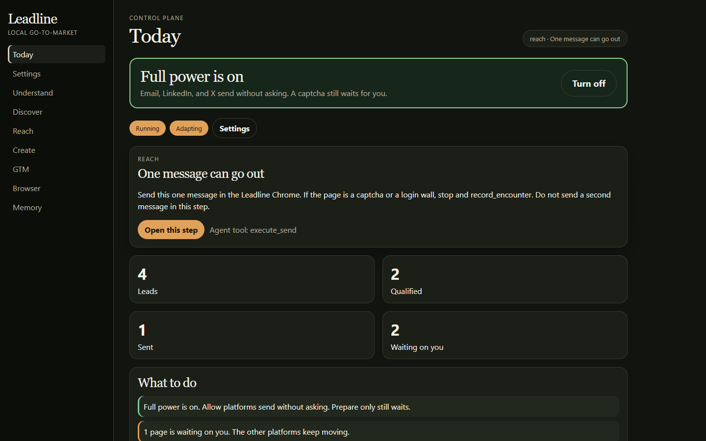
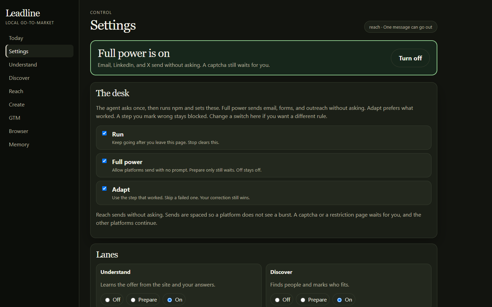
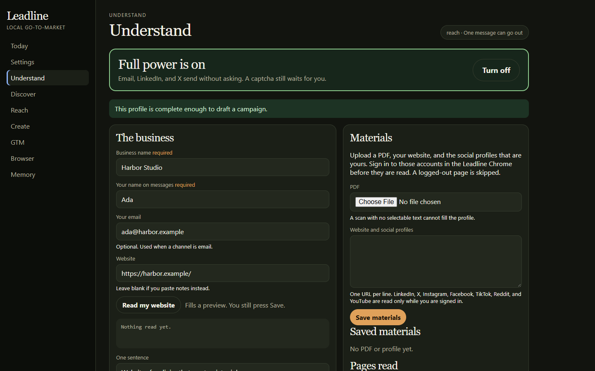
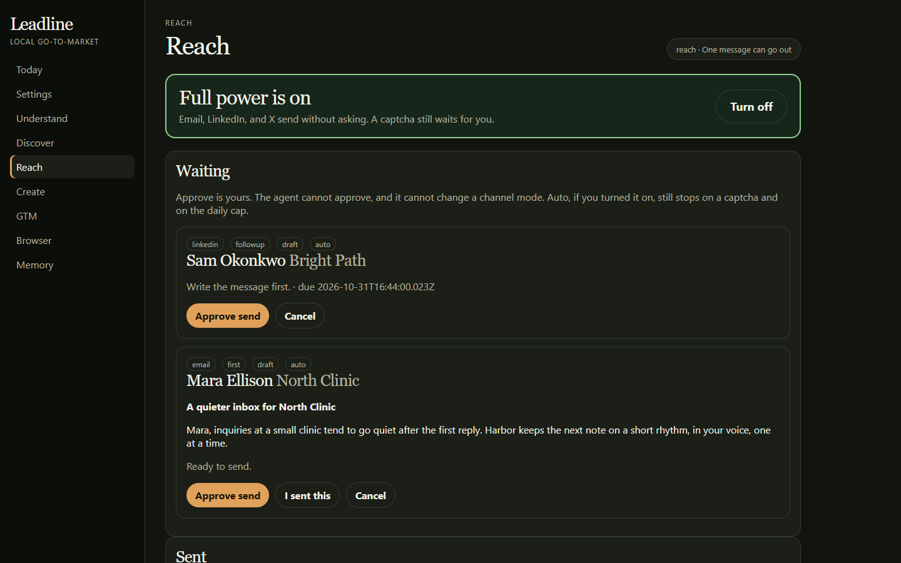
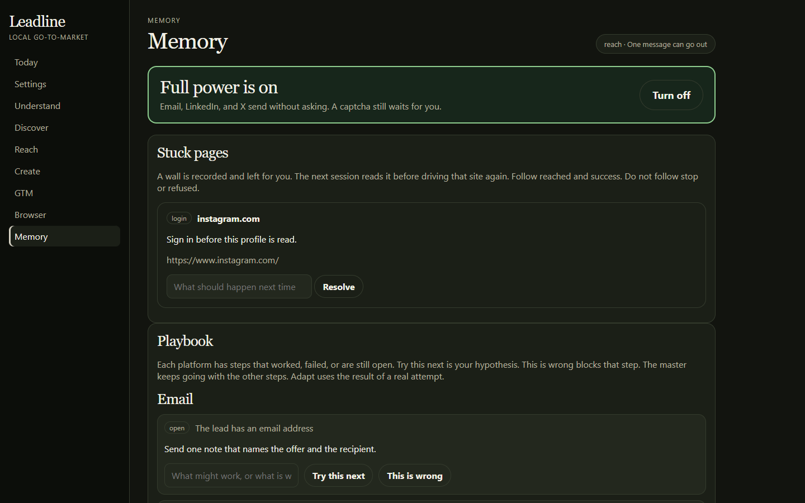
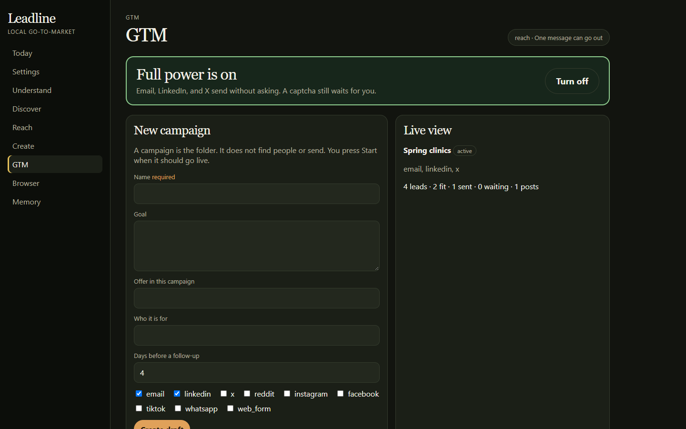

# ⚡ Leadline

**A local go-to-market desk. You say yes once. The crew does the work in your own Chrome.**

Most outreach tools want a seat in the cloud and a click on every sentence. Leadline stays on the machine in front of you. A coding agent is the crew. The app has no model of its own. It is the hands, the memory, and the gate.

You are asked one question: should it start? A plain yes means the agent installs, opens the desk, and sends email, forms, and outreach without asking again. “Yes, but ask before each send” starts the same desk and waits on Reach. No means stop.

The green bar at the top of every page is the throttle. **Full power** is on, or it is off. Prepare and Off still wait. A captcha, a login, or a restriction stops that page and leaves the rest of the desk moving.

<p align="center">
  
</p>

<p align="center"><i>Today. One next move, in plain language. The people in these pictures are a sample campaign on a local database, not a customer list.</i></p>

## 🖥 The desk

<table>
  <tr>
    <td width="50%">
      
      <br><b>⚙️ Settings.</b> Run, Full power, and Adapt sit above the lanes. One click on the bar saves.
    </td>
    <td width="50%">
      
      <br><b>🧭 Understand.</b> Type the offer, or hand over a PDF, your site, and the social profiles you are already signed into.
    </td>
  </tr>
  <tr>
    <td width="50%">
      
      <br><b>✉️ Reach.</b> One message can go. The follow-up is born empty, so nobody sends a blank second note.
    </td>
    <td width="50%">
      
      <br><b>🧠 Memory.</b> A wall is written down. The next session does not drive into it again.
    </td>
  </tr>
</table>

<p align="center">
  
</p>

<p align="center"><i>📌 GTM. A campaign is the folder. It does not find people, and it does not send.</i></p>

## 👥 The crew

| | Lane | What it owns |
| --- | --- | --- |
| 🧭 | **Understand** | The offer, the audience, and the lines that must not be invented |
| 🔎 | **Discover** | People from the open web, Reddit, and the sites you are signed into |
| ✉️ | **Reach** | One draft, one send, then a follow-up |
| ✨ | **Create** | Posts and assets. You publish them |
| 📌 | **GTM** | The campaign that ties the other four together |
| 📈 | **Virality** | One idea at a time. It does not spray the same post, and it does not click Post for you |
| 📍 | **Trace** | Where the run stopped. A line stays until that step is done. It does not send |

Each lane has its own permission: Off, Prepare, Ask first, or On. Reach is the only one that sends.

## 🎛 What you control

- ⚡ **Full power**, the bar under the title. On means Allow platforms send without a question each time.
- 🚦 **Per platform:** Don’t use, Prepare, or Allow. Email, LinkedIn, X, Reddit, Instagram, Facebook, TikTok, WhatsApp, and web forms.
- 📅 **A daily cap** on each platform. It resets at local midnight. Zero blocks that platform.
- 🧠 **Adapt.** Prefer a step that worked. Skip one that failed. “This is wrong” always wins, and the agent cannot clear it.

## 📅 A day on the desk

1. You answer once, in chat or on Today.
2. The agent runs `npm install` if it has to, then `npm start`. You do not open a terminal.
3. It learns the business from the form, a PDF, your website, or your own social profiles. A logged-out page is not used. Missing proof stays missing.
4. It opens a Chrome window on `data/chrome-profile`, port **9333**. That window is not your daily browser. You sign in there once.
5. Discover saves a person only after the page has been read. Fit is yes, maybe, or no.
6. Reach sends the one message Today names, then stops. A follow-up shell appears a few days later.
7. A captcha or a login is recorded under Memory. That platform waits. The others continue.

## 🚫 What it will not do

- It will not add a stealth plugin, spoof a fingerprint, or solve a captcha.
- It will not type a password, and it will not take over the Chrome profile you use all day.
- The agent cannot approve a message, mark one sent, or publish a post. `execute_send` is the only sender, and it re-checks the gate.
- A click on Send is not proof the other person received it.
- Virality never auto-posts.

## 🎬 Later, on Create

Not in this build. Create may plug in tools that make the pictures and the video: **Higgsfield**, **HeyGen**, and Google **Flow** (Veo 3 and Gemini).

The same place would run an A/B test and keep the score. You can see each thing on its own: the tool, the asset, the test, what worked, and what did not.

The screen stays one desk. Each thing has its own plain control, a short label, and room to change it. Nothing new is hidden in a second app.

## 🚀 Run

Node **22.13** or newer.

```bash
npm install
npm test
npm start
```

Open [http://127.0.0.1:7791](http://127.0.0.1:7791). State lives in `data/leadline.db`. That folder is gitignored. Screenshots of stuck pages land in `data/encounters/`.

Tell the agent one of these:

- **Yes.** Install, start the desk, turn Full power on, open Chrome, and work.
- **Yes, but ask before each send.** The same, with Full power left off.
- **No.** Stop. Do not run npm.

`npm run chrome` opens the Leadline window on its own. `npm run mcp` speaks MCP on stdio for Grok, Cursor, Claude, Gemini, VS Code, and Kiro. The client configs are already in the repo.

## 🤖 For the next agent

| Read this | Why |
| --- | --- |
| [`AGENTS.md`](AGENTS.md) | The operating rules and the tool list |
| [`docs/flows/`](docs/flows/) | One page per lane |
| [`ARCHITECTURE.md`](ARCHITECTURE.md) | Why there is one Chrome and one SQLite file |
| [`CODING_STANDARDS.md`](CODING_STANDARDS.md) | How to change the code without breaking the gate |

There is no approve tool. `begin` is the only start, and only after a person has answered.

## 📄 License

[MIT](LICENSE) © Maaz Bin Mustaqeem
