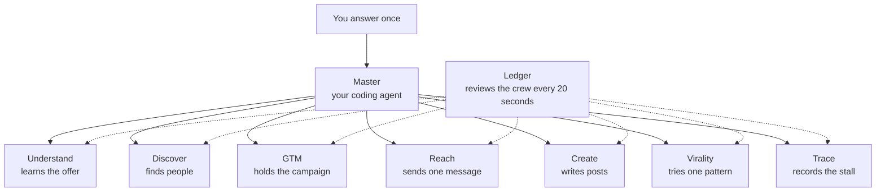
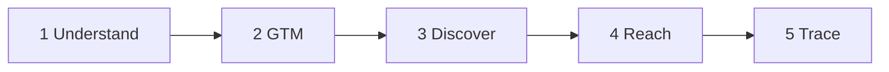
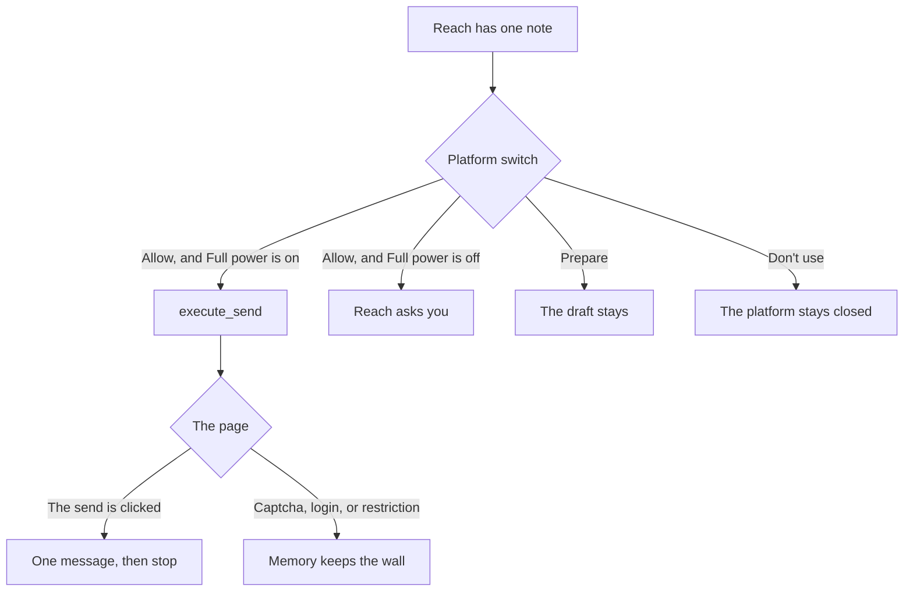

# Leadline

The desk stays on your machine. The coding agent you already use is the master. This repository is the crew: seven lanes, one ledger, one Chrome window, and one gate. Leadline holds no model of its own. It holds the hands, the memory, and the permission to send.

Hand this repository to that agent. It asks one question. You answer in the chat. The agent brings the desk up and carries the day. You sign in once, in the Chrome window it opens, and you publish the posts you want up.

## The question

The agent asks once: **Should I start Leadline?**

| Your answer | What the agent does |
| --- | --- |
| **Yes.** | Starts the desk, turns Full power on, and sends email, forms, and outreach without asking again. |
| **Yes, but ask before each send.** | Starts the same desk. Reach waits for you before each send. |
| **No.** | Stops. |

## Full power

A yes turns it on. The bar on Today and on Settings turns it off again.

When it is on:

- Reach sends an Allow message. It does not wait for a separate approval.
- Email, LinkedIn, and X move from Prepare to Allow. Any other platform stays on the switch you already set.
- Understand, Discover, GTM, Trace, and Reach are on.
- A drafted campaign starts on the next pass while Run is on.
- The daily cap still holds. Zero still blocks that platform for the day.
- A captcha, a login, or a restriction stops that one page. The other platforms continue.
- Prepare writes the draft and holds it. Don't use leaves the platform closed.
- Create still waits for you to publish. Virality still leaves the post to you.

When it is off, Reach asks before each send.

## The desk

The front shows the next step, the pipeline, and a door for every screen, in three groups: Desk, Work, and Control. The pipeline is the day from left to right: Understand, GTM, Discover, Reach, then Trace. Create and Virality sit beside it. Crew keeps the lane graph. The same groups are the list on the left. Every screen shows a breadcrumb back through its group to Today. The graph runs Understand, GTM, Discover, Reach, then Trace, with Create and Virality beside that path. Each screen opens on its own page. Each screen is one file, so the agent reads that slice and leaves the rest of the desk alone. About every 20 seconds the master checks the crew. A node says Working, Waiting on you, Needs a look, Off, or Paused. Under the graph, what just happened is a short path.

  

<i>Today. One next move, in plain language. The people in these pictures are a sample campaign on a local database. They are not a customer list.</i>

The day is filed in these rooms.

<table>
  <tr>
    <td width="50%">
      
       <b>Settings.</b> Run, Full power, and Adapt sit above the lanes. One click on the bar saves the rule for the day.
    </td>
    <td width="50%">
      
       <b>Understand.</b> You type the offer, or you hand over a PDF, your site, and the social profiles you are already signed into.
    </td>
  </tr>
  <tr>
    <td width="50%">
      
       <b>Reach.</b> One message can go. The follow-up is born empty, so a second note waits for real words.
    </td>
    <td width="50%">
      
       <b>Memory.</b> A wall is written down. The next session stops at that wall.
    </td>
  </tr>
</table>

  

<i>GTM. The folder the day is filed in. Discover finds the people. Reach sends.</i>

## The master and the crew

You talk to one master. That is the coding agent in the chat. The master calls one lane at a time. About every 20 seconds the desk checks the crew and paints that check on the graph: Working, Waiting on you, Needs a look, Off, or Paused.

While the desk is running, Understand, Discover, GTM, Reach, and Trace stay on. Create and Virality may stay off. Reach is the only sender. A lane that needs a look comes before a new search. The master names the Settings switch and waits. You turn the lane on.

| Lane | On while the desk runs | What this agent does |
| --- | --- | --- |
| Understand | Yes | Learns what you sell from your form, your site, and the profiles you are signed into. |
| Discover | Yes | Finds people and marks who fits. A person is saved only after the page has been read. |
| GTM | Yes | Keeps the campaign and the follow-up delay. You press Start. |
| Reach | Yes | Writes one note and sends one message, then stops. |
| Trace | Yes | Writes down where the run stopped, and keeps that line until the step is done. |
| Create | May stay off | Writes the posts. You publish them. |
| Virality | May stay off | Tries one pattern at a time and records what moved. You publish. |

The day runs in this order. Create and Virality sit beside it. A post is never a gate on a send.

Adapt prefers a step that worked and skips a step that failed. A step you mark wrong stays blocked. The master cannot clear it.

## Where a message can go

Each platform has its own mark, its own daily cap, and its own switch: Don't use, Prepare, or Allow. The cap resets at local midnight. Zero blocks that platform for the day. Turning Full power on moves Email, LinkedIn, and X from Prepare to Allow. You can switch them back before you save.

  
  
  
  
  
  
  
  
  

| | Platform | Cap | What Reach has |
| --- | --- | ---: | --- |
|  | Gmail | 30 | The mailbox in the Leadline Chrome window. |
|  | LinkedIn | 20 | The LinkedIn session in that same window. |
|  | X | 20 | The X session in that same window. |
|  | Instagram | 10 | The Instagram session in that same window. |
|  | Reddit | 10 | The Reddit session in that same window. |
|  | Facebook | 10 | The Facebook session in that same window. |
|  | TikTok | 10 | The TikTok session in that same window. |
|  | WhatsApp | 10 | WhatsApp Web. A QR code waits for you. |
|  | Web form | 15 | A public form on the open web. A captcha stops that page. |

The marks name the channels. They belong to their owners.

## One day

1. You answer in the chat.
2. The agent learns the business from the form, a PDF, your website, or your own social profiles. A logged-out page stays unread. Missing proof stays missing.
3. The agent opens Chrome on `data/chrome-profile`, port **9333**. That window belongs to this desk. You sign in there once.
4. Discover saves a person only after the page has been read. Fit is yes, maybe, or no.
5. Reach sends the one message the desk names, then stops. A few days later an empty follow-up appears and waits for real words.
6. A captcha or a login is written under Memory. That platform waits. The others continue.

## The lines

- No stealth plugin, no spoofed fingerprint, and no solved captcha.
- No typed password. A login wall is yours.
- The master cannot approve a message, mark one sent, or publish a post. `execute_send` is the only sender, and it checks the gate again.
- A click on Send records the click. Delivery is a separate fact.
- Virality records a pattern. You publish.
- Create writes a draft. You publish.

## A later chapter, on Create

This build stops at drafts you publish yourself. A later chapter may plug picture and video tools into Create: Higgsfield, HeyGen, and Google Flow, which brings Veo 3 and Gemini.

That chapter would run an A/B test and keep the score on this same desk. You would see each thing on its own: the tool, the asset, the test, what worked, and what did not. Each one gets a plain control and a short label.

## Hand the repository to your agent

Open this repository in Grok, Cursor, Claude, Codex, Gemini, VS Code, or Kiro. When the agent asks, answer with one line:

- **Yes.** Start the desk, turn Full power on, open Chrome, and work.
- **Yes, but ask before each send.**
- **No.**

The desk opens at [http://127.0.0.1:7791](http://127.0.0.1:7791). The story of the desk lives in `data/leadline.db`. That folder stays off git. Pictures of stuck pages land in `data/encounters/`.

The client configs are already in the repo. The agent connects, installs what is missing, and opens the desk. Your part is the answer, the sign-in, and the posts you choose to publish.

## How a change lands

GitHub Actions runs the tests. The check is named `test`. GitHub Copilot reviews the pull request. Main is protected: a direct push is rejected, and the pull request merges only after `test` is green. GitHub itself merges it. Copilot's review is advice. The test is the gate.

## For the next agent

| Read this | Why |
| --- | --- |
| [`AGENTS.md`](AGENTS.md) | The operating rules and the tool list. You run the install and the start. The person answers in the chat. |
| [`docs/flows/`](docs/flows/) | One page per lane, plus how a change ships. |
| [`ARCHITECTURE.md`](ARCHITECTURE.md) | Why there is one Chrome and one SQLite file. |
| [`CODING_STANDARDS.md`](CODING_STANDARDS.md) | How to change the code without breaking the gate. |

There is no approve tool. `begin` is the only start, and only after a person has answered.

## License

[MIT](LICENSE) © Maaz Bin Mustaqeem
